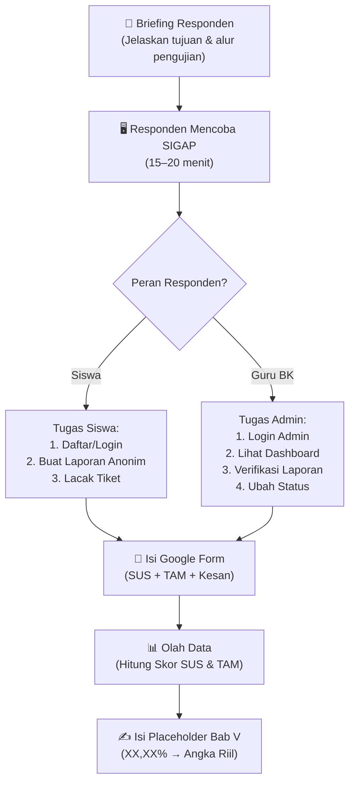

# 🧪 Brainstorming Form Pengujian SIGAP — Google Forms

> Saran rancangan formulir evaluasi untuk mengisi data empiris **Bab V (Results and Discussion)** pada naskah paper IEEE SIGAP.

---

## 📋 Ringkasan Kebutuhan Form

Berdasarkan struktur Bab V di `SIGAP.tex`, ada **3 instrumen yang perlu diisi oleh responden** melalui Google Forms, dan **2 instrumen internal** yang diisi sendiri oleh developer:

| # | Instrumen | Diisi Oleh | Media |
|---|---|---|---|
| 1 | **SUS** (System Usability Scale) | Responden (siswa & guru BK) | ✅ Google Form |
| 2 | **TAM** (Technology Acceptance Model) | Responden (siswa & guru BK) | ✅ Google Form |
| 3 | **Black-Box Testing** | Developer / Penguji internal | 📊 Spreadsheet manual |
| 4 | **NLP Classification Metrics** | Otomatis dari `pytest` / script | 🖥️ Output kode |
| 5 | **API Performance Benchmark** | Otomatis dari load testing tool | 🖥️ Output kode |

> [!TIP]
> **Rekomendasi:** Gabungkan **SUS + TAM** dalam **1 Google Form saja** agar responden hanya perlu mengisi sekali, tidak lelah buka 2 form terpisah. Pisahkan per *section* di dalam form.

---

## 🎯 Target Responden

| Kelompok | Jumlah Minimal | Peran di SIGAP |
|---|---|---|
| **Siswa** | 10–15 orang | Pelapor (menggunakan portal siswa: buat laporan, lacak tiket) |
| **Guru BK / Admin** | 3–5 orang | Pengelola laporan (dashboard admin, verifikasi, ubah status) |
| **Total** | **15–20 orang** | Campuran kedua peran |

> [!IMPORTANT]
> Paper menyebut "*XX responden yang terbagi atas dua kelompok peran: XX siswa sebagai pelapor dan XX guru BK/admin sebagai pengelola laporan*". Angka ini harus diisi dari data nyata responden Google Form.

---

## 📝 FORM 1 (Google Form Utama): Kuesioner Pengujian Penerimaan Pengguna SIGAP

### Section 1 — Data Responden
*(Wajib, untuk klasifikasi kelompok)*

| # | Pertanyaan | Tipe Input | Keterangan |
|---|---|---|---|
| 1 | Nama Lengkap | Teks singkat | Opsional (boleh anonim) |
| 2 | Peran Anda dalam pengujian | Dropdown | `Siswa (Pelapor)` / `Guru BK / Admin (Pengelola)` |
| 3 | Jenis Kelamin | Dropdown | `Laki-laki` / `Perempuan` |
| 4 | Kelas / Jabatan | Teks singkat | Misal: "XII IPA 2" atau "Guru BK" |

---

### Section 2 — System Usability Scale (SUS)
*(10 pertanyaan baku Brooke, skala Likert 1–5)*

> **Petunjuk pengisian:** Berikan penilaian Anda terhadap sistem SIGAP yang telah Anda coba. Pilih angka 1 (Sangat Tidak Setuju) sampai 5 (Sangat Setuju).

| # | Pernyataan SUS (Bahasa Indonesia) | Skala |
|---|---|---|
| S1 | Saya merasa akan sering menggunakan sistem SIGAP ini. | 1 – 2 – 3 – 4 – 5 |
| S2 | Saya merasa sistem ini terlalu rumit untuk digunakan. | 1 – 2 – 3 – 4 – 5 |
| S3 | Saya merasa sistem ini mudah digunakan. | 1 – 2 – 3 – 4 – 5 |
| S4 | Saya merasa membutuhkan bantuan orang lain atau teknisi untuk dapat menggunakan sistem ini. | 1 – 2 – 3 – 4 – 5 |
| S5 | Saya merasa berbagai fungsi dalam sistem ini terintegrasi dengan baik. | 1 – 2 – 3 – 4 – 5 |
| S6 | Saya merasa terlalu banyak ketidakkonsistenan dalam sistem ini. | 1 – 2 – 3 – 4 – 5 |
| S7 | Saya merasa kebanyakan orang akan dapat mempelajari sistem ini dengan cepat. | 1 – 2 – 3 – 4 – 5 |
| S8 | Saya merasa sistem ini sangat tidak praktis untuk digunakan. | 1 – 2 – 3 – 4 – 5 |
| S9 | Saya merasa sangat percaya diri saat menggunakan sistem ini. | 1 – 2 – 3 – 4 – 5 |
| S10 | Saya perlu belajar banyak hal terlebih dahulu sebelum dapat menggunakan sistem ini. | 1 – 2 – 3 – 4 – 5 |

> [!NOTE]
> **Cara hitung skor SUS:**
> - Pertanyaan ganjil (S1, S3, S5, S7, S9): Skor = jawaban – 1
> - Pertanyaan genap (S2, S4, S6, S8, S10): Skor = 5 – jawaban
> - Total = (jumlah seluruh skor) × 2,5
> - Hasil akhir: skala **0 – 100**
> - Interpretasi: **≥85** = Excellent, **70–84** = Good, **50–69** = Acceptable, **<50** = Poor
> - Target paper: **> 68** (above average)

---

### Section 3 — Technology Acceptance Model (TAM)
*(2 konstruk: PU & PEOU, masing-masing 5–6 item, Likert 1–5)*

> **Petunjuk pengisian:** Berikan penilaian Anda terhadap kegunaan dan kemudahan sistem SIGAP. Pilih angka 1 (Sangat Tidak Setuju) sampai 5 (Sangat Setuju).

#### A. Perceived Usefulness (PU) — Persepsi Kemanfaatan

| # | Pernyataan | Skala |
|---|---|---|
| PU1 | Menggunakan SIGAP mempercepat proses pelaporan kasus perundungan di sekolah. | 1 – 2 – 3 – 4 – 5 |
| PU2 | SIGAP membantu meningkatkan efektivitas penanganan kasus perundungan. | 1 – 2 – 3 – 4 – 5 |
| PU3 | SIGAP memudahkan pemantauan status penanganan laporan yang telah dibuat. | 1 – 2 – 3 – 4 – 5 |
| PU4 | Fitur triase AI pada SIGAP bermanfaat untuk menentukan kategori dan urgensi kasus secara otomatis. | 1 – 2 – 3 – 4 – 5 |
| PU5 | Secara keseluruhan, SIGAP bermanfaat untuk mendukung pencegahan dan penanganan perundungan di sekolah. | 1 – 2 – 3 – 4 – 5 |

#### B. Perceived Ease of Use (PEOU) — Persepsi Kemudahan Penggunaan

| # | Pernyataan | Skala |
|---|---|---|
| PEOU1 | Saya mudah memahami cara menggunakan SIGAP tanpa perlu pelatihan khusus. | 1 – 2 – 3 – 4 – 5 |
| PEOU2 | Tampilan antarmuka SIGAP terlihat jelas, rapi, dan mudah dinavigasi. | 1 – 2 – 3 – 4 – 5 |
| PEOU3 | Proses membuat laporan aduan di SIGAP dapat dilakukan dengan langkah yang sederhana. | 1 – 2 – 3 – 4 – 5 |
| PEOU4 | Saya mudah menemukan informasi atau fitur yang saya butuhkan di dalam SIGAP. | 1 – 2 – 3 – 4 – 5 |
| PEOU5 | Secara keseluruhan, SIGAP mudah dan nyaman untuk digunakan. | 1 – 2 – 3 – 4 – 5 |

> [!NOTE]
> **Cara hitung skor TAM:**
> - Rata-rata PU = (PU1 + PU2 + PU3 + PU4 + PU5) / 5
> - Rata-rata PEOU = (PEOU1 + PEOU2 + PEOU3 + PEOU4 + PEOU5) / 5
> - Skor TAM keseluruhan = (Rata-rata PU + Rata-rata PEOU) / 2
> - Hasil: skala **1,00 – 5,00**
> - Interpretasi: **≥4,20** = Sangat Baik, **3,40–4,19** = Baik, **2,60–3,39** = Cukup, **<2,60** = Kurang

---

### Section 4 — Kesan & Saran (Opsional)
*(Pertanyaan terbuka untuk data kualitatif pendukung)*

| # | Pertanyaan | Tipe Input |
|---|---|---|
| 1 | Apa hal yang paling Anda sukai dari sistem SIGAP? | Paragraf (opsional) |
| 2 | Apa kendala atau kesulitan yang Anda alami saat menggunakan SIGAP? | Paragraf (opsional) |
| 3 | Apakah ada fitur tambahan yang Anda harapkan tersedia di SIGAP? | Paragraf (opsional) |

---

## 🔧 INSTRUMEN INTERNAL (Bukan Google Form)

### Black-Box Testing — Matriks Skenario Fungsional
*(Diisi oleh developer saat menjalankan pengujian langsung di aplikasi)*

| No | Modul | Skenario Pengujian | Input | Output yang Diharapkan | Hasil | Status |
|---|---|---|---|---|---|---|
| 1 | Autentikasi & JWT | Login siswa dengan NISN valid | NISN + password benar | Redirect ke Dashboard Siswa, token JWT tersimpan | ✅ / ❌ | Lulus / Gagal |
| 2 | Autentikasi & JWT | Login siswa dengan password salah | NISN + password salah | Pesan error "Kredensial tidak valid" | ✅ / ❌ | Lulus / Gagal |
| 3 | Autentikasi & JWT | Login admin dengan NIP valid | NIP + password benar | Redirect ke Dashboard Admin | ✅ / ❌ | Lulus / Gagal |
| 4 | Autentikasi & JWT | Akses halaman admin tanpa token | URL langsung `/admin/dashboard` | Redirect ke halaman login admin | ✅ / ❌ | Lulus / Gagal |
| 5 | Pelaporan Multi-Step | Submit aduan anonim lengkap | Data step 1-2-3 valid | Kode tiket diterbitkan, data masuk MySQL | ✅ / ❌ | Lulus / Gagal |
| 6 | Pelaporan Multi-Step | Upload bukti melebihi 10 MB | File > 10 MB | Pesan error "Ukuran file melebihi batas" | ✅ / ❌ | Lulus / Gagal |
| 7 | Pelaporan Multi-Step | Upload file bukan gambar/PDF | File `.exe` atau `.sh` | Penolakan MIME type, file tidak tersimpan | ✅ / ❌ | Lulus / Gagal |
| 8 | Triase NLP | Submit aduan dengan narasi kekerasan fisik | Teks deskripsi "dipukul berkali-kali" | Kategori AI = Perundungan Fisik, confidence > 50% | ✅ / ❌ | Lulus / Gagal |
| 9 | Manajemen Admin | Tambah petugas baru via modal | NIP + nama + password | Akun tersimpan di MySQL, dapat login | ✅ / ❌ | Lulus / Gagal |
| 10 | Manajemen Admin | Hapus petugas non-super admin | Klik hapus pada petugas biasa | Akun dihapus dari MySQL, tidak bisa login lagi | ✅ / ❌ | Lulus / Gagal |
| 11 | Klaster & Dashboard | Lihat statistik dashboard admin | Akses halaman dashboard | Kartu statistik menampilkan jumlah laporan riil dari MySQL | ✅ / ❌ | Lulus / Gagal |
| 12 | Audit Trail | Ubah status laporan lalu cek audit trail | Ubah status dari "Menunggu" ke "Ditindaklanjuti" | Entri baru muncul di halaman Audit Trail | ✅ / ❌ | Lulus / Gagal |
| 13 | Pelacakan Tiket | Lacak tiket dengan kode valid | Kode tiket hasil submit | Status dan detail laporan ditampilkan | ✅ / ❌ | Lulus / Gagal |
| 14 | Pelacakan Tiket | Lacak tiket dengan kode tidak valid | Kode asal "XYZ-000" | Pesan "Tiket tidak ditemukan" | ✅ / ❌ | Lulus / Gagal |

> [!TIP]
> Jumlah skenario di atas: **14 test cases** melintasi **6 modul**. Sesuaikan dengan kebutuhan paper (paper menyebut "XX skenario uji").

---

## 🗺️ Alur Pengujian yang Disarankan



---

## 📐 Struktur Google Form yang Disarankan

```
📋 Form: "Kuesioner Pengujian Penerimaan Pengguna SIGAP"
│
├── Section 1: Data Responden (4 pertanyaan)
│   ├── Nama (opsional)
│   ├── Peran (Siswa / Guru BK)
│   ├── Jenis Kelamin
│   └── Kelas / Jabatan
│
├── Section 2: System Usability Scale (10 pertanyaan Likert)
│   ├── S1–S10 (masing-masing radio button 1–5)
│   └── Deskripsi: 1=Sangat Tidak Setuju, 5=Sangat Setuju
│
├── Section 3: Technology Acceptance Model (10 pertanyaan Likert)
│   ├── PU1–PU5 (Kemanfaatan)
│   ├── PEOU1–PEOU5 (Kemudahan)
│   └── Deskripsi: 1=Sangat Tidak Setuju, 5=Sangat Setuju
│
└── Section 4: Kesan & Saran (3 pertanyaan paragraf, opsional)
    ├── Hal yang disukai
    ├── Kendala yang dialami
    └── Fitur yang diharapkan
```

**Total pertanyaan: ~27 pertanyaan** (4 data diri + 10 SUS + 10 TAM + 3 opsional)
**Estimasi waktu pengisian: 5–8 menit**

---

## ⚙️ Pengaturan Google Form yang Disarankan

- **Require sign-in:** Tidak (agar responden nyaman, sesuai prinsip anonim SIGAP)
- **Limit 1 response:** Ya (per perangkat)
- **Shuffle question order:** Tidak (urutan SUS harus tetap S1–S10)
- **Progress bar:** Ya (agar responden tahu sudah sampai mana)
- **Confirmation message:** "Terima kasih telah berpartisipasi dalam pengujian SIGAP! Masukan Anda sangat berharga untuk pengembangan sistem."
- **Collect email addresses:** Tidak (menjaga anonimitas)
